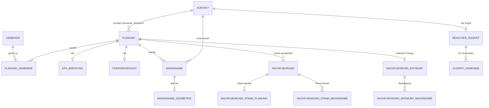

# Energieplanung Kanton Luzern – Datenmodell (Vorschlag, Version 1.5)

Stand: 2026-11-12 · Abgeleitet aus dem Prototyp `v1.5/` (Frontend mit Mock-Daten). Das ist ein **Vorschlag für eine relationale Datenbank**, kein bestehendes Schema.

Die fachlichen Regeln stehen in [Business-Rules.md](Business-Rules.md). Dieses Dokument beschreibt, welche Daten dafür gespeichert werden müssen und wie sie zusammenhängen.

> **Pflege:** Dieses Dokument wird bei jeder Änderung am Datenmodell mitgeführt (siehe `CLAUDE.md`). Der Änderungsverlauf steht am Ende.

---

## 1. Übersicht

Konventionen: Datumsfelder als `DATE`, Geldbeträge als ganzzahliger `INTEGER` (Franken), Ja/Nein/Keine Angabe als nullable `BOOLEAN` (`NULL` = keine Angabe). Die im Prototyp sichtbaren IDs `EP-<Nr>` und `M-<Nr>` sind **Anzeige-IDs**, intern genügt ein numerischer Primärschlüssel.

---

## 2. Tabellen

### gemeinde
| Feld | Typ | Hinweis |
|---|---|---|
| id | PK | |
| name | Text | eindeutig (79 Gemeinden des Kantons) |
| plz | Text | |
| grenze | Geometrie | Gemeindegrenze für die Karte |

### kontakt
| Feld | Typ | Hinweis |
|---|---|---|
| id | PK | |
| vorname, nachname | Text | Pflicht |
| organisation | Text | optional. Bei Gemeindekontakten «Gemeinde <Name>» |
| gemeinde_id | FK gemeinde | gesetzt = Gemeindekontakt, sonst externe Fachperson |
| email | Text | Pflicht |

Eindeutig: (vorname, nachname, organisation). Löschen nur, wenn der Kontakt in `planung` und `massnahme` und `epa_beratung` nirgends mehr referenziert wird (siehe Business-Rules, Abschnitt 5).

### benutzer_zugriff
| Feld | Typ | Hinweis |
|---|---|---|
| kontakt_id | PK/FK kontakt | eine Zeile je Person mit Zugriff |
| ist_admin | Boolean | Rolle Admin |
| ist_energieberater | Boolean | Rolle Energieberater/in |
| ist_gemeinde | Boolean | Rolle Gemeinde |

Mehrere Rollen gleichzeitig möglich. Keine Zeile oder alle drei `false` = kein Zugriff. Alternativ eine Tabelle `zugriff_rolle(kontakt_id, rolle)`.

### zugriff_gemeinde
| Feld | Typ | Hinweis |
|---|---|---|
| kontakt_id | FK | |
| gemeinde_id | FK | |

Die Gemeinden gelten gemeinsam für die Rollen Gemeinde und Energieberater/in. Admin braucht keine Einträge (sieht alles). Pflicht (mindestens eine Gemeinde) bei Rolle Gemeinde oder Energieberater/in.

### planung
| Feld | Typ | Hinweis |
|---|---|---|
| id | PK | Anzeige-ID `EP-<Nr>` |
| typ | Enum | `kommunal`, `regional` |
| name | Text | z. B. «Kommunale Energieplanung Adligenswil» |
| region_name | Text | nur bei regional |
| status | Enum | `Entwurf`, `Verabschiedung`, `Fördergesuch`, `Abschluss` |
| kontakt_gemeinde_id | FK kontakt | optional, muss ein Kontakt der betreffenden Gemeinde(n) sein |
| berater_id | FK kontakt | externe Fachperson |
| keine_externe_begleitung | Boolean | ersetzt den Prototyp-Sondertext «Aktuell keine externe Begleitung» |
| ziel_netto_null, ziel_energieeffizienz, ziel_stromproduktion | Text | mehrzeilig |

Nicht gespeichert: `jahr` (ergibt sich aus Beratungsbeginn bzw. geplantem Startjahr), `prozessstatus` in der Beratung (Kopie von `status`), `pruefstatus.letzteUeberpruefung` (ergibt sich aus der letzten `nachfuehrung`).

### planung_gemeinde
| Feld | Typ | Hinweis |
|---|---|---|
| planung_id | FK | |
| gemeinde_id | FK | |
| typ | Enum | Kopie von `planung.typ` |

**Eindeutig (gemeinde_id, typ):** Pro Gemeinde nur eine Energieplanung je Typ. Kommunal genau 1 Gemeinde, regional mindestens 2.

### epa_beratung
| Feld | Typ | Hinweis |
|---|---|---|
| planung_id | PK/FK | 1:1 |
| name | Text | |
| beratungsperson_id | FK kontakt | externe Fachperson |
| geplanter_start_jahr | SMALLINT (JJJJ) | nur Jahresplanung, kein Datum. Nur durch Admin änderbar. Überfällig, sobald das Jahr vorbei ist |
| beratungsbeginn | DATE | Start der Beratung. Basis der Nachführungsfristen |
| epa_abschluss | DATE | EPA Beratung abgeschlossen (Übergang zu Verabschiedung) |
| beratung_abschluss | DATE | Beratung abgeschlossen (Übergang zu Abschluss) |
| bedarf_energierichtplan, bedarf_koordination, gebiete_koordinationsbedarf | Boolean (nullable) | Ja / Nein / Keine Angabe |
| energiestadt | Text | Ja / Nein |
| kommentar | Text | intern |

### foerdergesuch
| Feld | Typ | Hinweis |
|---|---|---|
| planung_id | PK/FK | 1:1 |
| kontoinhaber, adresse, iban, bankname | Text | Konto lautet immer auf die Gemeinde. Pflicht ab Status Fördergesuch (ohne Bankname) |
| vermerk | Text | |
| gesuchseingang | DATE | gesetzt durch «Fördergesuch eingereicht» |
| gesuchs_nr | Zahl | eindeutig, Vorschlag aus Jahr + EP-Nr |
| auszahlungsbetrag | INTEGER | CHF, nur Admin |

### massnahme
| Feld | Typ | Hinweis |
|---|---|---|
| id | PK | Anzeige-ID `M-<Nr>` |
| planung_id | FK | |
| es_nr | Text | optional |
| name | Text | Pflicht |
| beschreibung | Text | Pflicht |
| aus_epa | Boolean | Pflicht (Ja/Nein) |
| handlungsfeld | Enum | siehe Abschnitt 3. Pflicht |
| aktivitaetsbereich | Enum | siehe Abschnitt 3. Pflicht |
| prioritaet | Enum | optional |
| status | Enum | `Geplant`, `Umsetzung`, `Abschluss`, `Verworfen` |
| startdatum | DATE | Pflicht |
| faelligkeitsdatum | DATE | Pflicht, **muss nach dem Startdatum liegen** |
| budget_chf | INTEGER | Pflicht, ganze Zahl |
| verantwortlich_id | FK kontakt | optional |
| bemerkungen | Text | Feld «Bemerkungen / aktueller Stand» |

Nicht gespeichert: `umsetzungszeitraum` (berechnet aus Start und Fälligkeit).

### massnahme_geometrie
| Feld | Typ | Hinweis |
|---|---|---|
| massnahme_id | PK/FK | 1:0..1 |
| art | Enum | Punkt, Linie, Kurve, Fläche |
| geometrie | Geometrie | GeoJSON |
| gemeinde_id | FK | Gemeinde, in der die Massnahme liegt |

---

## 3. Nachführung

Das Änderungsprotokoll braucht pro abgeschlossener Nachführung einen **Stand** der Daten. Vorschlag: eigene Tabellen (alternativ je ein JSON-Feld).

### nachfuehrung
| Feld | Typ | Hinweis |
|---|---|---|
| id | PK | |
| planung_id | FK | |
| datum | DATE | Datum der Durchführung. Grundlage der Fristberechnung |
| durchgefuehrt_von_id | FK kontakt | optional (Person, nicht im Protokoll angezeigt, aber gespeichert) |

### nachfuehrung_stand_planung
| Feld | Typ | Hinweis |
|---|---|---|
| nachfuehrung_id | PK/FK | |
| kontakt_gemeinde_id, berater_id | FK kontakt | Stand damals |
| keine_externe_begleitung | Boolean | |
| ziel_netto_null, ziel_energieeffizienz, ziel_stromproduktion | Text | |

### nachfuehrung_stand_massnahme
| Feld | Typ | Hinweis |
|---|---|---|
| nachfuehrung_id | FK | |
| massnahme_id | FK (ohne Löschkaskade) | auch später gelöschte Massnahmen bleiben referenzierbar bzw. werden als Text festgehalten |
| status, name, es_nr, beschreibung, handlungsfeld, aktivitaetsbereich, prioritaet, startdatum, faelligkeitsdatum, budget_chf, verantwortlich (Name als Text oder FK), bemerkungen | wie `massnahme` | Stand zum Zeitpunkt der Nachführung |

Daraus wird der Vergleich zur nächsten Nachführung berechnet: geänderte Personen/Ziele, neue/entfernte Massnahmen, neuer Status und geänderte Massnahmenangaben (siehe Business-Rules 4.3).

### nachfuehrung_entwurf und nachfuehrung_entwurf_massnahme
Zustand der **laufenden** Prüfung, bis sie abgeschlossen wird.

| Tabelle | Felder |
|---|---|
| nachfuehrung_entwurf | planung_id (PK/FK), personen_bestaetigt, ziele_bestaetigt, vorzeitig (Boolean), bearbeitung_seit, bearbeitung_begonnen_von, zuletzt_bearbeitet, zuletzt_bearbeitet_von |
| nachfuehrung_entwurf_massnahme | planung_id, massnahme_id, bestaetigt, beruehrt (geändert/importiert), neu_erfasst (in dieser Nachführung angelegt) |

Der Entwurf enthält Bestätigungsmarken und einen Bearbeitungsvermerk. Die geänderten Werte stehen direkt in `planung` und `massnahme`. Fachlich geklärt (2026-11-19): Wird eine Nachführung nicht abgeschlossen, bleiben sie dort stehen und sind für alle sichtbar, es gibt keine Momentaufnahme zum Zurücksetzen. Der Bearbeitungsvermerk (Zeitstempel und Benutzer) wird bei der ersten Änderung oder Bestätigung gesetzt und bei jeder weiteren aktualisiert. Er steuert nur den Hinweis «in Bearbeitung seit …» und die Anzeige der zuletzt bearbeitenden Person, es gibt keine Sperre (Business-Rules 4.4). Im Prototyp liegt der Entwurf (`nfPruefung`, Unterobjekt `bearbeitung`) nur im Arbeitsspeicher.

Beim Abschluss wird der Entwurf in `nachfuehrung` und die Stand-Tabellen übernommen und gelöscht.

---

## 4. Aufzählungen (Referenzlisten)

| Liste | Werte |
|---|---|
| Planungsstatus | Entwurf, Verabschiedung, Fördergesuch, Abschluss |
| Massnahmenstatus | Geplant, Umsetzung, Abschluss, Verworfen |
| Handlungsfeld | Übergeordnete Massnahmen / Strategien, Wärme- und Kälteversorgung, Energieeffizienz, Ausbaupfad erneuerbare Energien, andere |
| Aktivitätsbereich | Strategie / Planung, Information, Beratung, Förderung, Vorschrift, Vollzug, Vorbildfunktion |
| Priorität | Hoch, Mittel, Tief |
| Planungstyp | kommunal, regional |
| Rolle | Admin, Energieberater/in, Gemeinde |

---

## 5. Berechnete Werte (nicht speichern)

| Wert | Berechnung |
|---|---|
| Umsetzungszeitraum | Start- und Fälligkeitsjahr: «2026» oder «2025–2028» |
| Nächste Nachführungsfrist | Erste Frist = Beratungsbeginn + 4 Jahre. Danach je Nachführung: rechtzeitig/vorzeitig = Datum + 4 Jahre, verspätet = ursprüngliche Frist + 4 Jahre. Keine Frist mehr, wenn das Jahr ≥ 2050 (Business-Rules 4.2) |
| Anzahl erledigter Nachführungen / «n. Nachführung» | Anzahl Zeilen in `nachfuehrung` (+1 für die anstehende) |
| Phase der Nachführung | vorab, ruhend (> 12 Monate bis Frist), offen (≤ 12 Monate), fällig, keine |
| Prozessschritt | Personen, EPA Beratung, Massnahmen, Gesuch, Nachführung: aus Status und Beratungsbeginn |
| Massnahme überfällig | Fälligkeit vor heute und Status weder Abschluss noch Verworfen |
| Löschbar | Planung: nur durch Admin und nur im Schritt Personen. Kontakt: nirgends mehr eingetragen |

---

## 6. Wichtige Einschränkungen (Constraints)

- `planung_gemeinde`: eindeutig (gemeinde_id, typ).
- `massnahme`: `faelligkeitsdatum > startdatum`. Budget ≥ 0 und ganzzahlig.
- `foerdergesuch.gesuchs_nr`: eindeutig.
- `kontakt`: eindeutig (vorname, nachname, organisation).
- `kontakt` darf nicht gelöscht werden, solange er in `planung`, `epa_beratung` oder `massnahme` referenziert wird. Der Zugriff (`benutzer_zugriff`) wird beim Löschen mit entfernt.
- `planung` darf nur durch die Rolle Admin und nur im Prozessschritt «Personen» gelöscht werden (serverseitig erzwingen). Dabei werden die zugehörigen Massnahmen mitgelöscht.
- Sichtbarkeit: Nicht-Admins sehen nur Planungen, die mindestens eine ihrer freigeschalteten Gemeinden betreffen. Das muss serverseitig erzwungen werden.

---

## 7. Unterschiede zum Prototyp

- **Personen als Verweis:** Im Prototyp stehen Kontakte als Text («Vorname Nachname (Organisation)») in den Feldern. Im Datenmodell sind es Fremdschlüssel.
- **Status nur einmal:** `epaBeratung.prozessstatus` ist im Prototyp eine Kopie von `planung.status` und entfällt.
- **Sondertext als Flag:** «Aktuell keine externe Begleitung» ist im Prototyp ein Textwert und wird zu `keine_externe_begleitung`.
- **Stand der Nachführung:** Der Prototyp speichert ihn als verschachteltes Objekt (`stand.felder`, `stand.massnahmen`, `stand.namen`, `stand.details`). Hier ist er in Stand-Tabellen aufgeteilt.
- **Altdaten:** `nfBasisAnzahl` und `nfLegacyDatum` im Prototyp sind ein Behelf für Daten ohne Protokoll und gehören nicht ins Datenmodell.
- **EPA-Masterplan:** Die Reporting-Daten «EPA-Masterplan» sind im Prototyp eine separate Datei ohne Verbindung zu den Planungen. Sie sind hier nicht modelliert.

---

## Änderungsverlauf
| Datum | Änderung |
|---|---|
| 2026-11-19 | Tabelle `energietraeger` und Aufzählung «Energieträgertyp» entfernt. |
| 2026-11-19 | Feld `epa_beratung.foerderabschlussformular` (Stand des Formulars) entfernt (Abschnitt 3). |
| 2026-11-19 | `epa_beratung.geplanter_start` (DATE) ersetzt durch `geplanter_start_jahr` (JJJJ), nur Admin änderbar (Abschnitt 3). |
| 2026-11-19 | Löschen von `planung` nur durch Admin (Abschnitte 5, 6). |
| 2026-11-19 | Prozessschritt «Grunddaten» heisst neu «Personen» (Abschnitte 5, 6). `planung.name`, `typ` und Gemeinde(n) sind nach dem Anlegen unveränderlich. |
| 2026-11-19 | `nachfuehrung_entwurf`: Bearbeitungsvermerk ergänzt, offene Frage zum Abbruch geklärt (Abschnitt 3). |
| 2026-11-16 | Offene Frage zum Entwurf einer nicht abgeschlossenen Nachführung ergänzt (Abschnitt 3). |
| 2026-11-12 | Erstfassung (Planung, Massnahmen, Kontakte, Zugriff, Nachführung mit Stand und laufender Prüfung, Massnahmenstatus «Verworfen»). |
